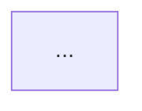
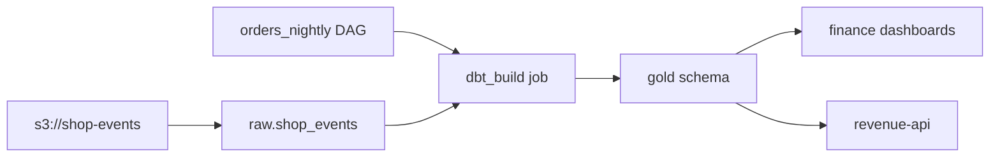
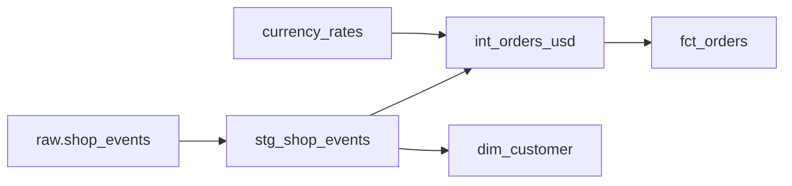
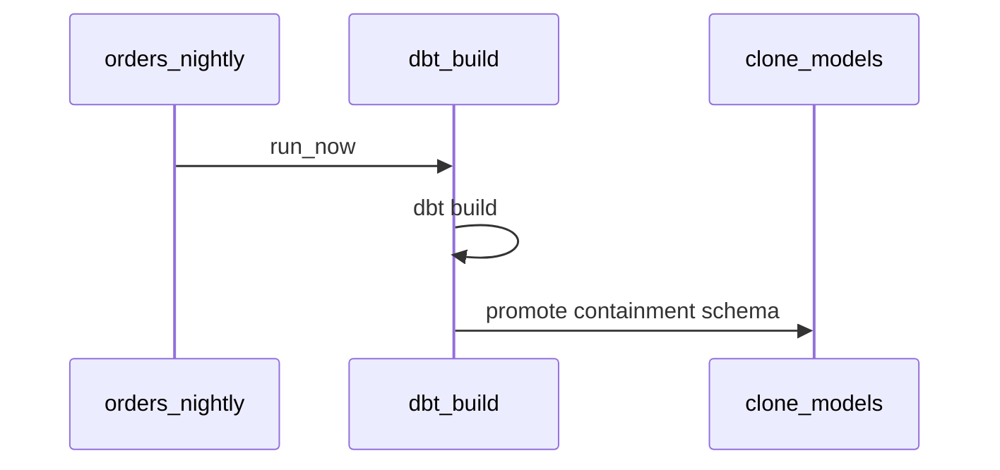

# ONE-PAGER.md

`ONE-PAGER.md` is the only note for human readers. A person reads it in two minutes. Claude reads the other notes for detail.

## Limits

1. Keep the file under 80 lines, diagrams included.
2. Use exactly 2 or 3 Mermaid diagrams:
   1. System context: `flowchart LR`. The repo, its triggers, upstream systems, and downstream consumers.
   2. Data flow: `flowchart LR`. Sources, main tables or topics, and sinks.
   3. Run or code flow (optional): `flowchart TD` or `sequenceDiagram`. Entry point to output.
3. Use a maximum of about 15 nodes in each diagram. If an area needs more, link to `code-flow.md` or `data-flow.md`.
4. Make each node label equal to a real identifier: a file, model, table, job, DAG ID, class, or function. Do not use invented names such as "Enrichment layer".
5. Use only `flowchart` and `sequenceDiagram`. Do not use `gantt`, `pie`, `style`, `classDef`, `linkStyle`, or `%%{init}%%` directives.
6. Put a label in double quotes when it has `(`, `)`, `/`, `.`, `:`, or spaces. Unquoted special characters break the parser.
7. List the top 5 risks. Each risk links to its entry in `known-issues.md` or `gotchas.md`. Do not copy the evidence.
8. List 3 to 5 files in "Where to start".
9. Do not add a `Checked` line or other metadata. `stamp` adds the `Checked` line.

## Template

````markdown
# <repo>: one-pager

## What it is

Two or three sentences: what the repo does, who uses the output, and what starts it.

## Inputs and outputs

| Inputs | Outputs |
|---|---|
| ... | ... |

## System context



## Data flow


## Run flow


## Top risks

1. ... See [known-issues.md](known-issues.md#confirmed-bugs).

## Where to start

- `path` : why to read it first.
````

## Example

This example is for a small dbt repo. The identifiers are illustrative.

````markdown
# orders-elt: one-pager

## What it is

orders-elt builds the order tables in the `gold` schema from raw shop events. An Airflow DAG starts a Databricks job each night. The finance dashboards and the `revenue-api` service read the output.

## Inputs and outputs

| Inputs | Outputs |
|---|---|
| `raw.shop_events` (Autoloader from S3) | `gold.fct_orders`, `gold.dim_customer` |
| `seeds/currency_rates.csv` | Elementary report in `/Volumes/prod/reports` |

## System context



## Data flow



## Run flow



## Top risks

1. `int_orders_usd` inner-joins `currency_rates`. Orders in a new currency drop with no error. See [known-issues.md](known-issues.md#confirmed-bugs).
2. Staging samples with `LIMIT` and no order. See [gotchas.md](gotchas.md#build-and-deploy).
3. A failed run leaves its containment schema. See [gotchas.md](gotchas.md#build-and-deploy).
4. `README.md` says the job runs hourly. See [known-issues.md](known-issues.md#doc-drift).
5. No test covers `dim_customer`. See [known-issues.md](known-issues.md#inferred-bugs).

## Where to start

- `databricks.yml`: job definitions and parameters.
- `models/silver/int_orders_usd.sql`: the main transform.
- `macros/clone_models.sql`: containment promote step.
- `.docs/README.md`: index of the detailed notes.
````
